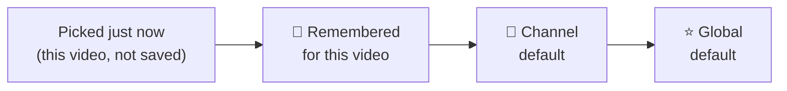

<p align="center">
  
</p>

<p align="center">
  
  
  
  
  
</p>

<p align="center">
  <b>YouTube often picks a lower quality than you want, and starts videos before you're ready.</b><br>
  Resolute puts a quality button right in the player, remembers what you like per video and per channel,<br>
  and, if you want, makes every video wait for <i>you</i> to press play.
</p>

<p align="center">
  <a href="#install">Install</a> ·
  <a href="#quality">Quality button</a> ·
  <a href="#autoplay">No autoplay</a> ·
  <a href="#popup">Popup</a> ·
  <a href="#faq">FAQ</a> ·
  <a href="PRIVACY.md">Privacy</a>
</p>

---

## ✨ What you get

| | |
|---|---|
| 🎚️ **Quality button in the player** | Next to the ⚙ gear. Auto, Highest, or 144p to 4K, in one click. Works in fullscreen too. |
| 📌 **Per-video memory** | "Remember for this video" and it always opens at that quality. |
| 👤 **Per-channel defaults** | 4K for one creator, 720p for another. Recognised by channel ID, so renames don't break it. |
| ⭐ **One global default** | For everything else. |
| ⏸️ **No more autoplay** *(optional)* | Videos open paused and start only when you press play. |
| 🔒 **Private by design** | No servers, no analytics, no network requests. Settings stay in your browser. |

---

<a id="quality"></a>
## 🎚️ Pick a quality in one click

<p align="center">
  <br>
  <sub>The in-player menu (design preview: the video behind it and the channel are example content).</sub>
</p>

A pick in the menu changes **only the video you're watching**. Saving is always a deliberate extra click:

| You click | What happens |
|---|---|
| A quality in the menu | Changes **this video only**. Nothing is saved; the next video goes back to normal. |
| 📌 **Remember for this video** | Saved. This video always opens at that quality. Click again to forget. |
| 👤 **Set as default for this channel** | Saved. Every video from this channel uses it. Click again to remove; pick another quality to **Update** it. |
| ★ **Make default for all videos** | Saved. Every video uses it, unless the video or its channel has its own setting. |

**Which setting wins when a video loads:**



The first one that exists is used. "Auto" means YouTube decides.

**Little things that help:**
- The dot on the button tells you where the quality comes from: none = global default, hollow ring = this video only, grey-violet = remembered, mauve = channel default.
- If a video doesn't have your quality, it uses the best one below it, and the menu says so ("Using 720p").
- Qualities a video doesn't offer are dimmed as "Not available".
- Keyboard: Tab to the button, ↑/↓ to open and move, Enter to pick, Esc to close.

---

<a id="autoplay"></a>
## ⏸️ No more autoplay

Off by default. Switch it on with the **⏸ button right next to YouTube's search box**, or in the toolbar popup. Both stay in sync.

<p align="center">
  <br>
  <sub>The ⏸ button in YouTube's light and dark themes. Grey = autoplay allowed; indigo = videos open paused.</sub>
</p>

| When it's on | What happens |
|---|---|
| You open a video (link, thumbnail, new tab) | Opens **paused** |
| A video ends and YouTube starts the next one | The next one opens **paused** |
| You press play (click/tap the player, **K**, **Space**, or a media key) | **Plays.** Your own play is never undone. |
| The browser blocked autoplay and you pressed play | **Plays** (your press counts) |
| An ad plays first | The ad is left alone; the real video after it opens **paused** |
| You type a space in the search box, or use the quality menu | Doesn't count as "play" |

---

<a id="popup"></a>
## 🗂️ The toolbar popup

<p align="center">
  <br>
  <sub>The real popup in light and dark, with example channels.</sub>
</p>

- Set the **global default** quality.
- Switch **Open videos paused** on or off.
- See every **channel default**: change its quality, remove it (×), or **Remove all**.
- Clear remembered videos with **Forget all**.
- Pick the popup theme: **System / Light / Dark**.

---

<a id="install"></a>
## 📦 Install

> Resolute isn't in any store yet. Firefox: [publishing guide](docs/PUBLISHING-FIREFOX.md) (planned for addons.mozilla.org, not yet submitted). Chrome: [manual install guide](docs/PUBLISHING.md) (not on the Chrome Web Store, because its registration fee isn't being paid).

**Chrome** (Developer mode)
1. Download this repo (**Code → Download ZIP**) and unzip it somewhere permanent.
2. Open `chrome://extensions` and turn on **Developer mode**.
3. Click **Load unpacked** and pick the folder that contains `manifest.json`.

It won't update by itself. A downloaded ZIP or `.crx` can't be installed by just opening it in Chrome on Windows or macOS.

**Firefox 140+**
- **Once it's listed** on Mozilla Add-ons: one click, automatic updates. Not available yet.
- **For testing now:**
  1. Open `about:debugging#/runtime/this-firefox`.
  2. Click **Load Temporary Add-on** and pick `manifest.json`. It's removed when Firefox closes.
  3. If the button doesn't appear, open `about:addons` → Resolute → **Permissions** and allow YouTube.

**Edge, Brave and other Chromium browsers:** each has its own rules; see the [Chrome guide, section 5](docs/PUBLISHING.md#5-legitimate-alternatives-for-chromium-based-browsers).

---

<a id="faq"></a>
## ❓ FAQ

<details>
<summary><b>Does it send my data anywhere?</b></summary>

No. There's no code that makes network requests. Your global default and the autoplay setting are kept in your browser's synced extension storage; remembered videos and channel defaults stay on this device only. Full details in the [privacy policy](PRIVACY.md).
</details>

<details>
<summary><b>Why does a video sometimes play 720p when I picked 1080p?</b></summary>

That video doesn't offer 1080p, so Resolute uses the best quality below it. The menu shows "Using 720p" so you always know.
</details>

<details>
<summary><b>How does it know which channel a video is from?</b></summary>

From the permanent channel ID (`UC…`) in YouTube's own player data for the video that's playing, never from the display name, so renamed channels keep their setting. The ID is only trusted when the data is for the same video that's playing, so one channel's setting never leaks onto another's video. If no ID shows up within about 2 seconds, the video uses your global default and the menu says "Channel not detected".
</details>

<details>
<summary><b>Will it break if YouTube changes its layout?</b></summary>

Playback is never affected. If YouTube moves its controls, the quality button falls back to a small floating control above the progress bar. If YouTube redesigns its top bar, the ⏸ button may not appear, but the popup switch keeps working.
</details>

<details>
<summary><b>Does it work on Shorts or the mobile site?</b></summary>

No. Shorts and m.youtube.com use a different player. "Open videos paused" also leaves Shorts and the muted hover previews on the home page alone.
</details>

---

## ⚠️ Known limits

- "Open videos paused" works by pausing a video right as it starts, so on a slow device you may hear a split second of sound first. YouTube offers no clean "don't autoplay" switch an extension can use.
- Channel defaults need the channel ID from YouTube's player data (`getPlayerResponse`). If YouTube stops providing it, videos fall back to the global default ("Channel not detected"). Nothing wrong is applied.
- Remembered videos and channel defaults stay on the device where you saved them (not synced).
- "Auto" after a forced quality uses `setPlaybackQualityRange('auto')`; verify on a real video.

---

## 🛠️ For developers

<details>
<summary><b>How it's built</b></summary>

| File | Job |
|------|-----|
| `page.js` | Runs in YouTube's page (the "MAIN" world) so it can use the player's own methods. Adds the quality button + menu, applies the quality on every new video, waits for ads. Adds the ⏸ button beside the search box and, when "Open videos paused" is on, pauses each video the first time it starts by itself. |
| `content.js` | Bridge to extension storage: the global default and the "Open videos paused" setting (both synced), remembered videos (this device, newest 1,000) and channel defaults (this device, newest 2,000). Validates every message and drops corrupted entries. |
| `popup.*` | The toolbar popup: global default, autoplay switch, channel defaults, remembered videos, theme, and a fix for switched-off YouTube access. |

The two scripts talk through `window.postMessage`. No build step, no bundler, no libraries.
</details>

<details>
<summary><b>Design</b></summary>

The popup, the in-player menu and the ⏸ button are **inspired by Material 3 Expressive** (not an official Material implementation):
- **Shapes:** pill buttons and chips, connected button groups, and a selected item that morphs from a pill to a rounded square.
- **Colour roles:** primary = global default, secondary = this video, tertiary = channel.
- **Motion:** spring-like, and switched off when the system's "reduce motion" setting is on.
- **Surfaces:** translucent and frosted. In the player, the video shows through the menu.
- **Theme:** the popup has System / Light / Dark. The in-player menu is always dark, like YouTube's own controls. The ⏸ button follows YouTube's light or dark top bar.
</details>

<details>
<summary><b>Run the tests</b></summary>

```
npm i jsdom
node test/page.test.js
node test/content.test.js
```
Runs the scripts against a fake YouTube player and fake storage: placement, menu, this-video picks, remember/forget, channel defaults (switching channels, missing or stale channel IDs, renamed channels, corrupted data), global default, fallback, ads, no duplicates, keyboard, and "Open videos paused" (paused on its own start, your play never undone, ads skipped, search-box typing and menu clicks not counted as play, the ⏸ button saving and following the popup).
</details>

<details>
<summary><b>Build the packages</b></summary>

```
python3 scripts/build.py chrome    # -> dist/resolute-chrome-v<version>.zip
python3 scripts/build.py firefox   # -> dist/resolute-firefox-v<version>.zip
```
</details>

---

<sub>Not affiliated with YouTube or Google. YouTube is a trademark of Google LLC.</sub>
