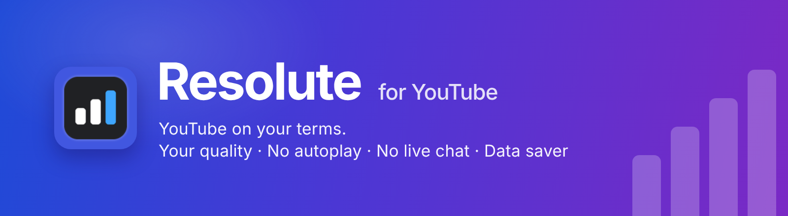
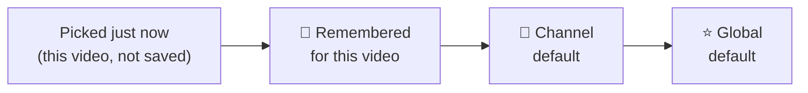
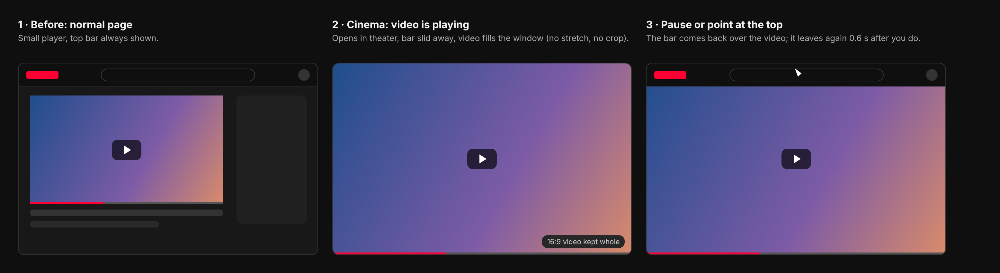
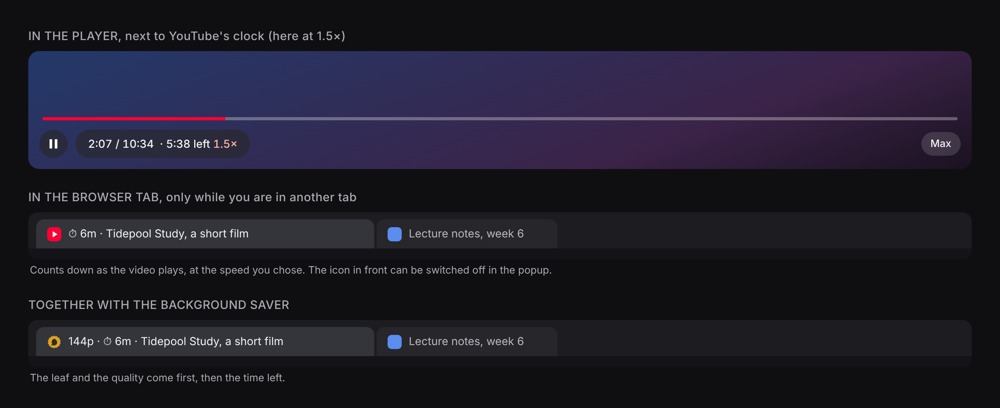

<p align="center">
  
</p>

<p align="center">
  
  
  
  
  
</p>

<p align="center">
  <b>Does YouTube play your videos in low quality? Does it start playing before you are ready?</b><br>
  Resolute fixes that. It adds a quality button inside the video player and remembers your choice for each video and each channel.<br>
  If you want, it can also stop videos from starting by themselves, hide the live chat and the top bar, open videos in a big cinema view, show the real time left, and save your data when you are on another tab.
</p>

<p align="center">
  <a href="#install">Install</a> ·
  <a href="#quality">Quality button</a> ·
  <a href="#autoplay">No autoplay</a> ·
  <a href="#chat">Hide live chat</a> ·
  <a href="#topbar">Hide top bar</a> ·
  <a href="#cinema">Cinema mode</a> ·
  <a href="#time-left">Time left</a> ·
  <a href="#saver">Background saver</a> ·
  <a href="#popup">Popup</a> ·
  <a href="#faq">FAQ</a> ·
  <a href="PRIVACY.md">Privacy</a>
</p>

---

## ✨ What you get

| Feature | What it does, in simple words |
|:---|:---|
| 🎚️ **Quality button in the player** | A small button next to the ⚙ gear. Pick Auto, Highest, or any quality from 144p to 4K with one click. It works in fullscreen too. |
| 📌 **Remember per video** | Press "Remember for this video" and that video always opens in the quality you chose. |
| 👤 **Remember per channel** | Like 4K for one creator and 720p for another. It follows the channel even if the channel changes its name. |
| ⭐ **One default for everything else** | Pick one quality that is used for all other videos. |
| ⏸️ **No more autoplay** *(optional)* | Two separate switches: one for videos you open, one for the next video in a playlist. Videos wait until you press play. |
| 💬 **Hide live chat** *(optional)* | The chat next to a live stream closes by itself. Press **Show chat** if you want it back. |
| 🫥 **Hide top bar** *(optional)* | YouTube's top bar slides away while the video plays, so you see more of the video. Pause or point at the top and it comes back. |
| 🎬 **Cinema mode** *(optional)* | Videos open in theater mode and fill your window, without stretching or cutting anything. |
| 🍃 **Background saver** *(optional)* | Listening to music in a tab you are not looking at? The quality goes down to use less data, and comes back when you return. |
| ⏯️ **Pick up where you stopped** | YouTube sometimes forgets. Resolute remembers the spot and jumps back when you open the video, with a small "Resumed at 12:29 · Start over" note. |
| ⏱️ **Time left at your speed** | Next to the clock you see how long the video really takes at your speed. If you are in another tab, the tab name shows the time left too. |
| 🔒 **Private** | It has no servers, no tracking and no internet requests. Your settings stay in your browser. |

---

<a id="quality"></a>
## 🎚️ Pick a quality in one click

<p align="center">
  <br>
  <sub>The real in-player menu, rendered from the extension's own code on a stand-in player. The video behind it and "Example Channel" are placeholders.</sub>
</p>

When you pick a quality in the menu, it changes **only the video you are watching**. Saving is always an extra click that you choose:

| You click | What happens |
|:---|:---|
| A quality in the menu | Changes **this video only**. Nothing is saved. The next video goes back to normal. |
| 📌 **Remember for this video** | Saved. This video always opens in that quality. Click again to forget it. |
| 👤 **Set as default for this channel** | Saved. Every video from this channel uses it. Click again to remove it. |
| ★ **Make default for all videos** | Saved. Every video uses it, unless the video or its channel has its own choice. |

**Which choice wins when a video opens?** Resolute checks these in order and uses the first one it finds:



"Auto" means YouTube decides.

**Small things that help:**
- The little dot on the button shows where the quality came from: no dot = your default for everything, hollow ring = this video only, pink = remembered video, gold = channel default.
- If a video does not have your quality, Resolute uses the best one below it and the menu tells you (for example "Using 720p").
- Qualities that a video does not have are greyed out ("Not available").
- With the keyboard: press Tab to reach the button, ↑ or ↓ to open the menu and move, Enter to pick, Esc to close.

---

<a id="autoplay"></a>
## ⏸️ No more autoplay

There are two settings. Both are off at first, and each one works on its own:

| Setting | When it is on |
|:---|:---|
| ▶ **Videos I open** | A video you click, open from a link, or open in a new tab starts **paused**. |
| ⏭ **Next in queue or playlist** | When a video ends and YouTube starts the next one by itself, the next one starts **paused**. |

What this means in real life:

| When it is on and... | What happens |
|:---|:---|
| You open a video (link, thumbnail, new tab) | It opens **paused**. |
| A video ends and YouTube starts the next one | The next one opens **paused**. |
| You press play (click the player, **K**, **Space**, or a media key) | It **plays**. Resolute never undoes your own play. |
| Your browser blocked autoplay and you press play | It **plays**. |
| An ad comes first | The ad is left alone. The real video after it opens **paused**. |
| You type a space in the search box, or use the quality menu | This does not count as pressing play. |

### The button next to YouTube's search box

When you are not pointing at it, it is one small shape next to the mic button. The shape itself tells you what is on:

<p align="center">
  <br>
  <sub>Rendered from the extension's own code on a stand-in for YouTube's top bar.</sub>
</p>

- **▶ or ⏸ in the middle** means "Videos I open" (⏸ means they wait for you).
- **The wavy ring** is like YouTube's "up next" countdown. It unwinds when next videos wait.
- **The shape and colour** show how much is on: grey circle = nothing, soft wavy "cookie" = one setting, solid rounded square = both.

Point at it and it **opens up into a split button**. It floats over empty space, so YouTube's page never shifts:

<p align="center">
  
</p>

- Click the **shape or the words** to switch both settings together ("No autoplay" or "Autoplay").
- Click the **arrow** to open a small menu with one switch for each setting. The menu looks like frosted glass: you can see the page behind it, a little blurred.

<p align="center">
  <br>
  <sub>The colourful tiles are placeholder thumbnails, there to show the blur. Everything else is the extension's real code.</sub>
</p>

With the keyboard: press Tab to reach the button (it opens), Enter switches both, ↓ opens the menu, Space switches one setting, Esc closes. On a narrow window YouTube hides its search box, so the button moves next to the icons on the right, and a tap opens the menu. The popup has the same two switches, and they always match.

### When Resolute holds a video, the button tells you

<p align="center">
  <br>
  <sub>Rendered from the extension's own code on a stand-in for YouTube's top bar.</sub>
</p>

1. The button opens by itself and says **"Video waiting"** with a red **▶ Play**. So you see the reason and the fix in one place.
2. After 5 seconds it closes again and leaves a **red dot** until the video plays.
3. Play the video **any way you like**: the button's Play, the player's ▶, a click on the video, **Space**, **K**, or a media key. The button says **"Playing"** once and steps aside. If you pause the video yourself later, the button stays quiet, because Resolute did not pause it.

---

<a id="topbar"></a>
## 🫥 Hide top bar

Off by default. Switch it on in the toolbar popup.

On a video page, YouTube's top bar (the logo, search box and icons) moves away while the video **plays**, and the page moves up to use the space. On every other page the bar stays as it is.

| What happens | What you see |
|:---|:---|
| The video plays | The bar slides up and fades away. |
| You pause | The bar comes back. |
| You point at the top edge or the bar | The bar comes back, and leaves a moment after your pointer does. |
| You press **/** (YouTube's search key) or click the search box | The bar comes back and stays while you use search. **Esc** sends it away again. |
| An account, notification or Resolute menu is open | The bar stays. |
| You type in a comment or live chat | Nothing changes. Your letters are never taken. |
| Fullscreen | Left to YouTube, which already hides its bar. |
| "Reduce motion" is on in your computer | The bar fades instead of sliding. |

It only moves YouTube's own bar. Nothing is deleted or clicked.

---

<a id="cinema"></a>
## 🎬 Cinema mode

Off by default. Switch it on in the toolbar popup.

<p align="center">
  <br>
  <sub>Drawn on a stand-in for a YouTube watch page, using the same rules the extension uses.</sub>
</p>

When you open a video, it goes into theater mode, the top bar hides while it plays (same as **Hide top bar**), and the video fills your window **without stretching or cutting**. You see black bars only if the video's shape is different from your window's shape.

| What happens | What you see |
|:---|:---|
| You open a video | Theater mode turns on once for that video. |
| You leave theater mode (with the button or the **T** key) on a channel | That channel stays normal next time. |
| You turn theater back on for that channel | The channel opens in theater again. |
| Fullscreen | Left to YouTube (a page cannot start fullscreen on its own). |
| **Forget all** in the popup | Every channel you left out is cleared. |

Only your own click or key press counts as "leaving" theater. The extension's own actions never do. The channels you left out are saved on this device only.

---

<a id="time-left"></a>
## ⏱️ Time left at your speed

This is always on. YouTube shows the full length of a video, but at 1.5× speed it really takes much less time. Resolute shows the **real time left** next to YouTube's clock. When you are in another tab, it also shows the time left in the tab name.

<p align="center">
  <br>
  <sub>Drawn on a stand-in for a YouTube page, using the same text the extension produces.</sub>
</p>

| Where | What you see |
|:---|:---|
| **In the player** | `· 5:38 left 1.5×` after YouTube's clock. At normal speed it shows just `· 8:27 left`. It is hidden during ads, on live streams, and when the player is small. |
| **In the browser tab** | When you are in another tab, the tab name starts with `⏱ 6m`. It rounds up to whole minutes, shows seconds in the last minute, and shows `1h 20m` for long videos. It follows speed changes and skipping ahead. |
| **With the Background saver** | `144p · ⏱ 6m · title`, with the saver's leaf icon. Both go away when you come back. |
| **Icon switch** | In the popup: **Playing** page, **Time left**. On = ⏱ while playing and ⏸ when paused. Off = just the time. |

Nothing is sent anywhere. The numbers come from the video on your page.

---

<a id="chat"></a>
## 💬 Hide live chat

Off by default. Switch it on in the toolbar popup.

When you open a live stream, a premiere or a stream replay, Resolute closes the chat next to the video. It presses **YouTube's own close button**, so nothing on the page breaks.

| What happens | What you see |
|:---|:---|
| You open a stream that has chat | The chat closes as soon as it has loaded. |
| You click YouTube's **Show chat** | The chat opens and **stays open** for that video. |
| You open the next stream | Its chat closes again. |
| A normal video (no chat) | Nothing happens. |
| The creator turned chat off | Nothing happens. Resolute stops looking after about a minute. |

---

<a id="resume"></a>
## ⏯️ Pick up where you stopped

On by default. Resolute saves where you are while you watch. Next time you open that video, it jumps back to that spot. A small note shows **"Resumed at 12:29"** with a **Start over** button. The note fades after 6 seconds.

In the popup, on the **Playing** tab:
- **Rewind a little:** *Exact* goes to the very second. *5 seconds* goes back 5 seconds. *Smart* (default) goes back 2 seconds if you were away less than an hour, 5 seconds if less than a week, and 10 seconds after that.
- **What counts as progress:** live streams are included, the first 10 seconds are not saved, the last 30 seconds count as finished (the video starts fresh next time), and videos under 3 minutes are skipped. Each of these is a switch. **Shorts are never saved.**

Resolute does not jump if the link already has a time in it, or if YouTube already resumed the video itself. The spots stay on your device (the 1,000 most recent videos).

### On the progress bar

For a video you have watched before, Resolute adds a few things where you can see them. Each one has a switch in the popup, on the **Playing** tab, under **On the progress bar**.

- **Spot flag:** a small flag on the bar where you stopped. Point at the bar to see its time. Click it to go there.
- **Watched-last-time fill:** a lighter stripe on the bar, up to your old spot.
- **Back chip:** skip more than 30 seconds yourself and a chip says **"Back to 12:35"** for 8 seconds. One click and you are back. It does not show for jumps YouTube makes by itself.
- **Button by the clock:** a small pill with the time you left off. It opens a menu: **Jump to your spot**, **Start over**, **Don't save this video** and **Forget this spot**. The dot on the pill is red while the video is being saved and hollow when you chose not to save it. A video you chose not to save is also not resumed.

---

<a id="saver"></a>
## 🍃 Background saver

Off by default. Switch it on in the toolbar popup.

Sometimes a video keeps playing in a tab you are not looking at (music, a podcast, a long stream). Resolute lowers it to the **lowest quality** (or **480p**, your choice) after **15 seconds, 30 seconds or 1 minute**. When you come back, your quality returns right away. You will see a short pause each time, because YouTube reloads the video whenever its quality changes, both when it goes down and when it comes back. In tests, YouTube ignored a quality range, so there is no smoother way.

| What is happening | What Resolute does |
|:---|:---|
| Tab hidden, video playing | After the delay, it goes to the lowest quality (or 480p). |
| While it is saving | The **tab** shows it. The tab name starts with **"144p ·"** and the tab icon becomes Resolute's gold leaf. The tab is the only part of YouTube you can see while you are away. |
| You come back | Your quality returns, the tab goes back to normal, and the popup adds what was saved to **this week**. |
| The next video in a playlist starts while you are away | It stays low too. |
| The video is **side by side** with the tab you are using (Chrome split view, Vivaldi tiling) | **Never lowered**, because you can still see it on your screen. |
| The video is in **picture-in-picture** | **Never lowered**, and nothing is shown or counted. If you open picture-in-picture while it is saving, your quality comes back at once. |
| The video is paused, or an ad is playing | Left alone. A paused video uses no data. |

**How do I know it worked?** You cannot see it on the video, because your quality is back as soon as you return. There are three places to check:
- **When it starts:** you get a notification, *"Background saver: 144p"*. It goes away by itself when you go back to the tab, and clicking it takes you there.
- **While you are away:** the tab name starts with **"144p ·"** (point at the tab to see the full name).
- **After you are back:** the popup's **"Last time"** line, for example *"Last time: 1080p → 144p for 2 min 10 s · about 16 MB · 3 min ago"*. If it did not lower the video, the line tells you why (you came back too early, the video was paused, it was muted so the browser paused it, it was in picture-in-picture, or it was already that low).

> **Muted videos:** Chrome, Edge and Vivaldi pause a *muted* video in a background tab on their own, so there is nothing to save. In Vivaldi, the **Tab Muting** setting can mute background tabs for you. Set it to **Play All Audio** if you want videos to keep playing in other tabs.

The popup card also shows about how much data you saved **this week (Sunday to Saturday)**, as one number and one bar for each day (today is red). It is an **estimate**. YouTube does not tell us how much data was used, so Resolute multiplies typical video speeds by the minutes the video really played at the lower quality.

**Works on:** Chrome, Edge, or **Firefox 153 and newer**. These browsers tell the extension when a video is in picture-in-picture. On older Firefox, the saver stays off (the switch is greyed out with a note), so it can never lower a video you are watching.

---

<a id="popup"></a>
## 🗂️ The toolbar popup

<p align="center">
  <br>
  <sub>The real popup's three pages in dark (top) and light (bottom), rendered from the extension's code. The channels and counts are example data.</sub>
</p>

The popup has three pages, so you never have to scroll a long list:
- **Quality**: default quality, channel defaults, remembered videos.
- **Playing**: the switches for start paused, hide chat, hide top bar, Cinema mode, the time-left icons, and the resume settings (rewind a little, what counts as progress).
- **Saver**: the background saver and its weekly estimate.

Tap a tab, press the left or right arrow key while a tab is selected (Home and End work too), or swipe on a touch screen.

What you can do in the popup:
- Set the **default quality** for all videos.
- Switch **Videos I open** and **Next in queue or playlist** to start paused.
- Turn **Hide live chat** on or off.
- Turn **Hide top bar** on or off.
- Turn **Cinema mode** on or off, and forget the channels you left out.
- Turn the **icons in the tab countdown** (⏱ and ⏸) on or off.
- Turn the **Background saver** on or off, choose when it starts and how low it goes, and see this week's estimate.
- See every **channel default**: change its quality, remove it with ×, or use **Remove all**.
- Clear remembered videos with **Forget all**.
- Pick the popup theme: **System, Light or Dark**.

---

<a id="install"></a>
## 📦 Install

Choose your browser below. It takes about a minute.

| Your browser | Easiest way | Updates itself? |
|:---|:---|:---:|
| 🦊 **Firefox 140+** | [**Add it from Mozilla Add-ons**](https://addons.mozilla.org/en-US/firefox/addon/resolute-video-quality-control/) | ✅ Yes |
| 🟢 **Chrome** | Load the folder yourself (below) | ❌ No |
| 🔷 **Edge, Brave, Opera, Vivaldi** | Same steps as Chrome | ❌ No |

Safari and phone browsers are not supported.

### 🦊 Firefox (recommended)

1. Open the [Resolute page on Mozilla Add-ons](https://addons.mozilla.org/en-US/firefox/addon/resolute-video-quality-control/) in Firefox.
2. Click **Add to Firefox**, then **Add** in the box that appears.
3. Open any YouTube video. The quality button is in the player, next to the gear.

It updates by itself. If the button does not appear, open `about:addons`, click **Resolute**, go to **Permissions**, and allow YouTube.

### 🟢 Chrome (and other Chromium browsers)

Resolute is not on the Chrome Web Store, so you add it from a folder on your computer. You only do this once.

1. On this page click the green **Code** button, then **Download ZIP**.
2. **Unzip it** and move the folder somewhere it can stay (for example `Documents`). Chrome keeps using the files in this folder, so do not delete or move it later.
3. Open `chrome://extensions` (Edge: `edge://extensions`, Brave: `brave://extensions`).
4. Turn on **Developer mode** (top right).
5. Click **Load unpacked** and choose the folder that **contains `manifest.json`**. Inside the unzipped folder there may be one more folder with the same name: open it until you can see `manifest.json`, then select that.
6. Open a YouTube video. The quality button is in the player, next to the gear.

To make the button easy to reach, click the puzzle-piece icon in the toolbar and pin **Resolute**.

**Updating:** download the new ZIP, unzip it over the old folder (replace the files), then open `chrome://extensions` and click the round **reload** arrow on Resolute. Refresh your YouTube tab.

Chrome may show a "Disable developer mode extensions" notice when it starts. Click **Cancel** or the **X**; the extension keeps working.

### 🛠️ Firefox, for testing a new version

You only need this if you want to try a version that is not on Mozilla Add-ons yet. Do **not** use GitHub's "Download ZIP" here, because Firefox cannot read it.

1. Run `python3 scripts/build.py firefox`. It makes `dist/resolute-firefox-v<version>.zip`.
2. Open `about:debugging#/runtime/this-firefox`.
3. Click **Load Temporary Add-on** and pick that ZIP file (no need to unzip it).

Firefox removes it when you close it, so load it again next time.

### Something went wrong?

| What you see | What it means |
|:---|:---|
| "manifest.json was not found" | You picked a folder or ZIP with another folder inside it. Pick the one that shows `manifest.json` straight away. |
| No quality button on YouTube | Refresh the YouTube tab. Then check that Resolute is allowed on YouTube (Firefox: `about:addons` → Resolute → Permissions). |
| Button is there but the popup shows a warning | Click **Allow on YouTube** in the popup. |
| It stopped after a browser update (Chrome) | Open `chrome://extensions` and make sure Resolute is still switched on. |

---

<a id="faq"></a>
## ❓ FAQ

<details>
<summary><b>Does it send my data anywhere?</b></summary>

No. Resolute has no code that uses the internet. Your settings (default quality, the autoplay switches, hide live chat, hide top bar, Cinema mode, tab icons and the saver) are saved in your browser's own extension storage and sync with your browser account if you use sync. Remembered videos, the spots where you stopped watching, channel defaults, the channels Cinema mode leaves normal, and the saver's daily numbers stay on this device only. You can read all the details in the [privacy policy](PRIVACY.md).
</details>

<details>
<summary><b>Why does a video sometimes play in 720p when I picked 1080p?</b></summary>

That video does not have 1080p, so Resolute uses the best quality below it. The menu shows "Using 720p" so you always know.
</details>

<details>
<summary><b>How does it know which channel a video is from?</b></summary>

It reads the channel's permanent ID (it starts with `UC`) from YouTube's own player data. It never uses the channel's name, so a channel that changes its name keeps its setting. Resolute only trusts the ID when it belongs to the video that is playing, so one channel's setting never lands on another channel's video. If no ID shows up within about 2 seconds, the video uses your default for all videos, and the menu says "Channel not detected".
</details>

<details>
<summary><b>What if YouTube changes how its page looks?</b></summary>

Your videos will still play normally. If YouTube moves its controls, the quality button becomes a small floating button above the progress bar. If YouTube changes its top bar, the autoplay button may not show, but the switch in the popup still works. If YouTube changes its chat, the chat just stays open. If YouTube changes its theater button, Cinema mode simply does not turn theater on. Nothing else is affected.
</details>

<details>
<summary><b>Does it work on Shorts or on the phone website?</b></summary>

No. Shorts and m.youtube.com use a different player. The autoplay switches also leave Shorts and the small muted previews on the home page alone.
</details>

---

## ⚠️ Good to know

- The "MB or GB saved" number is an **estimate**. It is worked out from typical YouTube video speeds, not measured.
- **Vivaldi** never tells a page that it is in the background. So the saver also asks the browser which tab you are on, and checks if the page is still being drawn on screen. That is why a tab **side by side** with your current tab keeps its quality. Starting takes about 1.5 seconds longer there, which does not matter next to the 15 second or longer delay.
- While the saver is working, the tab name starts with "144p ·". If you bookmark or share the page at that moment, the name will include it. The same is true for the time-left sign.
- Firefox's own picture-in-picture button should count as picture-in-picture from Firefox 153, because it is the same signal the browser gives. Please test it on your Firefox before you rely on it.
- The autoplay switches work by pausing a video right when it starts. On a slow computer you may hear a tiny bit of sound first. YouTube has no clean "do not autoplay" setting that an extension can use.
- "Next in queue or playlist" means the earlier video played to its end and you did not click or type before the next one started. If you click something at that moment, the next video counts as one you opened.
- The smooth spring animations need Chrome 113 or newer (Firefox 112 or newer). On Chrome 111 and 112 everything works the same, just without the animation.
- Channel defaults need the channel ID from YouTube's player data. If YouTube stops giving it, videos use your default for all videos ("Channel not detected"), and nothing wrong is applied.
- **Hide top bar** moves YouTube's top bar with CSS. If YouTube renames those parts, the bar just stays where it is until Resolute is updated. The hidden bar can still be reached with **/** and Tab, so search keeps working.
- **Cinema mode** clicks YouTube's own theater button once for each video, then makes the video fill the window without cutting it. If YouTube renames the button, theater just does not turn on. Only your own click or the **T** key counts as leaving theater.
- **Hide live chat** presses the close button inside YouTube's chat. If YouTube renames that button, the chat stays open until Resolute is updated. A chat that loads more than about a minute after the page opens is left open.
- **Time left** is hidden during ads, on live streams, and in small players. It adds one small label inside YouTube's clock. If YouTube renames that part, the label is simply not shown. The tab countdown rounds up to whole minutes (seconds in the last minute), and you can switch off the ⏱ sign on the popup's **Playing** page.
- Remembered videos and channel defaults stay on the device where you saved them. They are not synced to your other devices.
- After a forced quality, "Auto" uses YouTube's own automatic mode. This has not been checked on every kind of video, so please try it on a real one.

---

## 🛠️ For developers

You do not need this part to use Resolute. It is for people who want to look inside or help.

<details>
<summary><b>How it is built</b></summary>

| File | What it does |
|:---|:---|
| `page.js` | Runs inside the YouTube page itself, so it can use the player's own functions. It adds the quality button and menu and sets the quality on every new video (it waits for ads to finish). It also adds the autoplay button next to the search box and pauses a video the first time it starts by itself (it can tell "opened by you" from "next in the queue"). It shows "Video waiting" while a video is held, closes the live chat once per video, slides the top bar away while a video plays, and (Cinema mode) turns theater on and makes the video fill the window. It also shows the time left, and runs the background saver (tab hidden, not in picture-in-picture) with its tab name and icon. Each of these only works if you switched it on. |
| `background.js` | Tells each YouTube tab if it is the selected tab of its window (Vivaldi keeps background tabs "visible" to pages, so the page also checks that it is no longer being drawn). It also shows the "Background saver: 144p" notification while a tab is lowered, and removes it when you return. |
| `content.js` | The bridge to the extension's storage. It holds the default quality, the autoplay switches, the hide-chat, hide-top-bar, Cinema mode, tab-icons and saver settings (all synced), and, on this device only: the saver's daily numbers (last 21 days), remembered videos (newest 1,000), channel defaults (newest 2,000) and the channels Cinema mode leaves normal (newest 2,000). It checks every message and throws away damaged entries. |
| `popup.*` | The toolbar popup, with three pages (Quality, Playing, Saver), a sliding tab bar and swipe. It has every setting above, the channel defaults, remembered videos, the theme, and a fix for when YouTube access is switched off. |

`page.js` and `content.js` talk to each other through `window.postMessage`. There is no build step, no bundler and no libraries.
</details>

<details>
<summary><b>Design</b></summary>

The popup, the in-player menu and the autoplay button are **inspired by Material 3 Expressive** (they are not an official Material version):
- **Shapes:** pill buttons and chips, joined button groups, and a chosen item that changes from a pill into a rounded square.
- **Colours (from a red starting colour):** red = default for all videos, dusty pink = this video, gold = channel.
- **Moving shapes:** the autoplay button changes its shape (circle, cookie, rounded square) and has a wavy ring, like Material's wavy progress bar.
- **Motion:** springy and smooth. It is switched off when your system's "reduce motion" setting is on.
- **Popup layout:** it follows the autoplay menu: small group titles, joined glass rows with an icon at the start, a red row for every setting that is on, and a short note under each group, on three pages with a sliding tab bar. A channel's quality opens the same kind of frosted menu.
- **Glass look:** real frosted glass (`backdrop-filter`). In the player you can see the video through the quality menu, and on the page you can see the page through the autoplay menu. Browsers that cannot blur get plain solid surfaces.
- **Theme:** the popup can be System, Light or Dark. The in-player menu is always dark, like YouTube's own controls. The autoplay button and its menu follow YouTube's light or dark theme.
</details>

<details>
<summary><b>Run the tests</b></summary>

```
npm i jsdom
node test/page.test.js
node test/content.test.js
node test/background.test.js
```
The tests run the scripts against a fake YouTube player and fake storage. They check these things:

- **Quality:** placement, the menu, this-video picks, remember/forget, the global default, the floating fallback, ads, no duplicate buttons, keyboard.
- **Channel defaults:** switching channels, missing or stale channel IDs, renamed channels, corrupted data.
- **Autoplay settings:** "opened" vs. "next in queue" detection, each setting on its own, your play never undone, ads skipped, search-box typing and menu clicks not counted as play, switching on never pausing the video already playing.
- **Autoplay button:** unfolding, toggling both, the menu, keyboard, following the popup; "Video waiting" with every play method, your own pause staying quiet, a different video clearing it.
- **Hide live chat:** off by default, waits until the chat has loaded, closes it once per video so **Show chat** stays open, closes it again on the next stream, leaves it alone when switched off.
- **Hide top bar:** off by default, away while playing, back on pause / pointer / focus / open menu, Esc lets it go, fullscreen and other pages untouched, switching off restores it.
- **Cinema mode:** off by default, theater on once per video, channels you leave stay normal and are undone when you turn theater back on, only real clicks/**T** count, fullscreen and non-watch pages untouched, switching off restores the page.
- **Time left:** real time left at the current speed in the player (any speed, ads/live/small player hidden, survives YouTube rebuilding its clock) and in the tab only while away (rounding, hours, seconds, follows speed and seeking, clears on return), together with the saver's prefix and leaf icon, ⏱/⏸ switchable.
- **Background saver:** off by default, the delay, lowest or 480p, the tab title and icon, the next playlist video staying low, picture-in-picture never lowered or counted, paused time not counted, daily estimates kept for 21 days.
</details>

<details>
<summary><b>Build the packages</b></summary>

```
python3 scripts/build.py chrome    # -> dist/resolute-chrome-v<version>.zip
python3 scripts/build.py firefox   # -> dist/resolute-firefox-v<version>.zip
```
</details>

---

<sub>Not affiliated with YouTube or Google. YouTube is a trademark of Google LLC.</sub>
