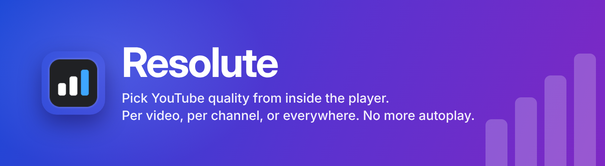
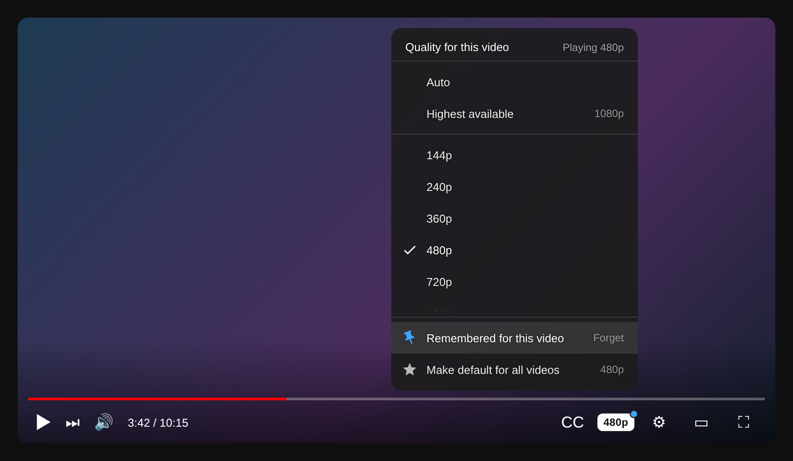
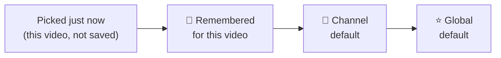
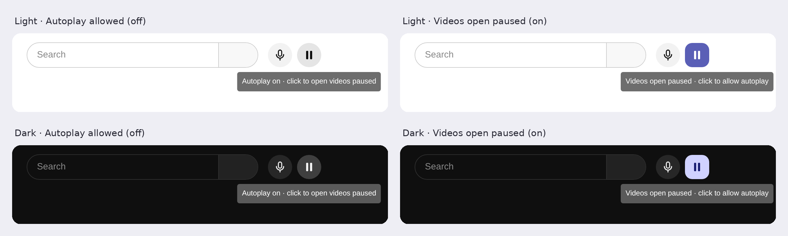
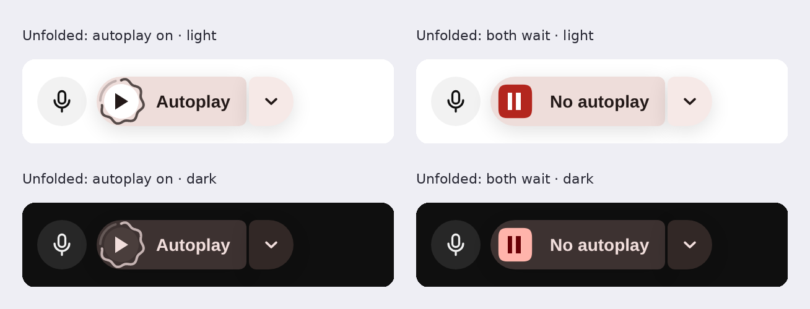
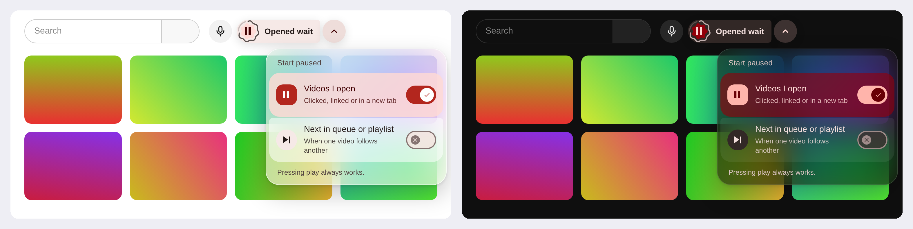
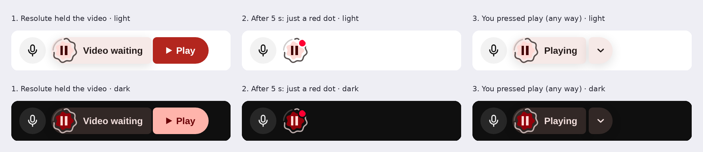
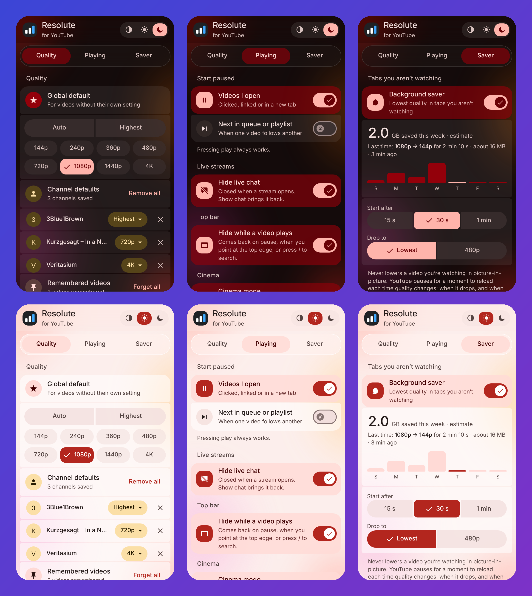

<p align="center">
  
</p>

<p align="center">
  
  
  
  
  
</p>

<p align="center">
  <b>YouTube often picks a lower quality than you want, and starts videos before you're ready.</b><br>
  Resolute puts a quality button right in the player, remembers what you like per video and per channel,<br>
  and, if you want, makes every video wait for <i>you</i> to press play, and saves data in tabs you aren't watching.
</p>

<p align="center">
  <a href="#install">Install</a> ·
  <a href="#quality">Quality button</a> ·
  <a href="#autoplay">No autoplay</a> ·
  <a href="#saver">Background saver</a> ·
  <a href="#popup">Popup</a> ·
  <a href="#faq">FAQ</a> ·
  <a href="PRIVACY.md">Privacy</a>
</p>

---

## ✨ What you get

| Feature | What it does |
|:---|:---|
| 🎚️ **Quality button in the player** | Next to the ⚙ gear. Auto, Highest, or 144p to 4K, in one click. Works in fullscreen too. |
| 📌 **Per-video memory** | "Remember for this video" and it always opens at that quality. |
| 👤 **Per-channel defaults** | 4K for one creator, 720p for another. Recognised by channel ID, so renames don't break it. |
| ⭐ **One global default** | For everything else. |
| ⏸️ **No more autoplay** *(optional)* | Two separate switches: videos you open, and the next video in a queue or playlist, can each start paused until you press play. |
| 🍃 **Background saver** *(optional)* | Playing music in a tab you're not looking at? Quality drops to save data and comes back when you return. Never touches picture-in-picture. |
| 🔒 **Private by design** | No servers, no analytics, no network requests. Settings stay in your browser. |

---

<a id="quality"></a>
## 🎚️ Pick a quality in one click

<p align="center">
  <br>
  <sub>The real in-player menu, rendered from the extension's own code on a stand-in player. The video behind it and "Example Channel" are placeholders.</sub>
</p>

A pick in the menu changes **only the video you're watching**. Saving is always a deliberate extra click:

| You click | What happens |
|:---|:---|
| A quality in the menu | Changes **this video only**. Nothing is saved; the next video goes back to normal. |
| 📌 **Remember for this video** | Saved. This video always opens at that quality. Click again to forget. |
| 👤 **Set as default for this channel** | Saved. Every video from this channel uses it. Click again to remove; pick another quality to **Update** it. |
| ★ **Make default for all videos** | Saved. Every video uses it, unless the video or its channel has its own setting. |

**Which setting wins when a video loads:**



The first one that exists is used. "Auto" means YouTube decides.

**Little things that help:**
- The dot on the button tells you where the quality comes from: none = global default, hollow ring = this video only, dusty pink = remembered, gold = channel default.
- If a video doesn't have your quality, it uses the best one below it, and the menu says so ("Using 720p").
- Qualities a video doesn't offer are dimmed as "Not available".
- Keyboard: Tab to the button, ↑/↓ to open and move, Enter to pick, Esc to close.

---

<a id="autoplay"></a>
## ⏸️ No more autoplay

Two settings, each off by default and independent of the other:

| Setting | When it's on |
|:---|:---|
| ▶ **Videos I open** | A video you click, follow a link to, or open in a new tab starts **paused** |
| ⏭ **Next in queue or playlist** | When a video ends and the next one starts by itself (autoplay, playlist, queue), that one starts **paused** |

What that means in practice:

| When it's on and… | What happens |
|:---|:---|
| You open a video (link, thumbnail, new tab) | Opens **paused** |
| A video ends and YouTube starts the next one | The next one opens **paused** |
| You press play (click/tap the player, **K**, **Space**, or a media key) | **Plays.** Your own play is never undone. |
| The browser blocked autoplay and you pressed play | **Plays** (your press counts) |
| An ad plays first | The ad is left alone; the real video after it opens **paused** |
| You type a space in the search box, or use the quality menu | Doesn't count as "play" |

### The button next to YouTube's search box

At rest it's one small shape beside the mic button, and the shape *is* the state:

<p align="center">
  <br>
  <sub>Rendered from the extension's own code on a stand-in for YouTube's top bar.</sub>
</p>

- **▶ or ⏸ in the middle** = Videos I open (⏸ means they wait for you).
- **The wavy ring** is YouTube's "up next" countdown. It unwinds when next videos wait.
- **The shape and tint** show how much is on: grey circle = nothing, soft scalloped "cookie" = one setting, solid rounded square = both.

Point at it and it **unfolds into a split button** (it floats over empty space, so YouTube's layout never moves):

<p align="center">
  
</p>

- Click the **shape or the words** to switch both settings at once ("No autoplay" ↔ "Autoplay").
- Click the **chevron** for a menu with a switch for each setting. Like the quality menu, it's frosted glass: whatever is behind it shows through, blurred.

<p align="center">
  <br>
  <sub>The colourful tiles are placeholder thumbnails, there to show the blur. Everything else is the extension's real code.</sub>
</p>

Keyboard: Tab to the button (it unfolds), Enter toggles both, ↓ opens the menu, Space switches, Esc closes. In narrow windows YouTube hides the search box, so the button moves next to the right-hand icons and a tap opens the menu. The popup has the same two switches; all of them stay in sync.

### When Resolute holds a video, the button tells you

<p align="center">
  <br>
  <sub>Rendered from the extension's own code on a stand-in for YouTube's top bar.</sub>
</p>

1. The button unfolds on its own: **"Video waiting"** and a red **▶ Play**. The cause and the fix sit in one place.
2. After 5 seconds it folds back, leaving a **red dot** until the video plays.
3. Play it **any way you like**: the button's Play, the player's ▶, a click on the video, **Space**, **K** or a media key. The button says **"Playing"** once and steps aside. If you pause it yourself later, the button stays quiet, because Resolute didn't pause it.


---

<a id="saver"></a>
## 🍃 Background saver

Off by default. Switch it on in the toolbar popup.

When a video keeps playing in a tab you aren't looking at (music, a podcast, a long stream), Resolute drops it to the **lowest quality** (or **480p**, your choice) after **15 s, 30 s or 1 min**, and puts your quality back the moment you return. Coming back may buffer for a moment while quality climbs back.

| Situation | What happens |
|:---|:---|
| Tab hidden, video playing | After the delay: lowest quality (or 480p) |
| While it's saving | The **tab** shows it: the title starts with **"144p ·"** and the tab icon becomes Resolute's gold leaf. The tab is the only part of YouTube you can see while you're away. |
| You come back | Your quality returns, the tab goes back to normal, and the popup adds what was saved to **this week** |
| The next video in a playlist starts while you're away | It stays low too |
| Video **tiled or split side by side** with the tab you're using | **Never lowered**: it's still being drawn on your screen (Chrome split view, Vivaldi tab tiling) |
| Video in **picture-in-picture** | **Never lowered**, and nothing is shown or counted. Entering PiP while saving restores your quality at once. |
| Video paused, or an ad playing | Left alone (a paused video uses no data) |

**How do I know it worked?** You can't see it on the video, because your quality is back the moment you return. Three places tell you:
- **The moment it starts:** a notification, *"Background saver: 144p"*. It disappears by itself when you go back to the tab; clicking it takes you there.
- **While you're away:** the YouTube tab's title starts with **"144p ·"** (hover over the tab to see the full title).
- **After you're back:** the popup card's **"Last time"** line, for example *"Last time: 1080p → 144p for 2 min 10 s · about 16 MB · 3 min ago"*. If it didn't lower the video, the line says why (you came back before the delay, the video was paused, it was in picture-in-picture, or it was already that low).

The popup card also shows roughly how much data it saved **this week (Sunday to Saturday)**, as a rolling number and one bar per day (today in red). It's an **estimate**: YouTube doesn't report data use, so Resolute multiplies typical bitrates by the minutes the video actually played while lowered.

**Needs:** Chrome, Edge, or **Firefox 153+**. These browsers tell an extension when a video is in picture-in-picture; on older Firefox versions the saver stays off (the switch is greyed out with a note), so it can never lower a video you're watching.

---

<a id="popup"></a>
## 🗂️ The toolbar popup

<p align="center">
  <br>
  <sub>The real popup in light and dark, rendered from the extension's code. The channels and counts are example data.</sub>
</p>

- Set the **global default** quality.
- Switch **Videos I open** and **Next in queue or playlist** to start paused.
- Switch the **Background saver** on or off, choose when it starts and how low it goes, and see this week's estimate.
- See every **channel default**: change its quality, remove it (×), or **Remove all**.
- Clear remembered videos with **Forget all**.
- Pick the popup theme: **System / Light / Dark**.

---

<a id="install"></a>
## 📦 Install

> Resolute isn't in any store yet. Firefox: [publishing guide](docs/PUBLISHING-FIREFOX.md) (planned for addons.mozilla.org, not yet submitted). Chrome: [manual install guide](docs/PUBLISHING.md) (not on the Chrome Web Store, because its registration fee isn't being paid).

### Chrome (Developer mode)

1. Download this repo (**Code → Download ZIP**) and unzip it somewhere permanent.
2. Open `chrome://extensions` and turn on **Developer mode**.
3. Click **Load unpacked** and pick the folder that contains `manifest.json`.

It won't update by itself. A downloaded ZIP or `.crx` can't be installed by just opening it in Chrome on Windows or macOS.

### Firefox 140+

- **Once it's listed** on Mozilla Add-ons: one click, automatic updates. Not available yet.
- **For testing now:**
  1. Open `about:debugging#/runtime/this-firefox`.
  2. Build it with `python3 scripts/build.py firefox`, click **Load Temporary Add-on** and pick `dist/resolute-firefox-v1.1.0.zip` (the repo's own `manifest.json` is set up for Chrome). It's removed when Firefox closes.
  3. If the button doesn't appear, open `about:addons` → Resolute → **Permissions** and allow YouTube.

### Edge, Brave and other Chromium browsers

Each has its own rules; see the [Chrome guide, section 5](docs/PUBLISHING.md#5-legitimate-alternatives-for-chromium-based-browsers).

---

<a id="faq"></a>
## ❓ FAQ

<details>
<summary><b>Does it send my data anywhere?</b></summary>

No. There's no code that makes network requests. Your global default, the two autoplay settings and the saver setting are kept in your browser's synced extension storage; remembered videos, channel defaults and the saver's daily estimates stay on this device only. Full details in the [privacy policy](PRIVACY.md).
</details>

<details>
<summary><b>Why does a video sometimes play 720p when I picked 1080p?</b></summary>

That video doesn't offer 1080p, so Resolute uses the best quality below it. The menu shows "Using 720p" so you always know.
</details>

<details>
<summary><b>How does it know which channel a video is from?</b></summary>

From the permanent channel ID (`UC…`) in YouTube's own player data for the video that's playing, never from the display name, so renamed channels keep their setting. The ID is only trusted when the data is for the same video that's playing, so one channel's setting never leaks onto another's video. If no ID shows up within about 2 seconds, the video uses your global default and the menu says "Channel not detected".
</details>

<details>
<summary><b>Will it break if YouTube changes its layout?</b></summary>

Playback is never affected. If YouTube moves its controls, the quality button falls back to a small floating control above the progress bar. If YouTube redesigns its top bar, the autoplay button may not appear, but the popup switch keeps working.
</details>

<details>
<summary><b>Does it work on Shorts or the mobile site?</b></summary>

No. Shorts and m.youtube.com use a different player. The autoplay settings also leave Shorts and the muted hover previews on the home page alone.
</details>

---

## ⚠️ Known limits

- The background saver's "MB/GB saved" is an estimate from typical YouTube bitrates, not a measurement.
- **Vivaldi** never tells a page it's in the background, so the saver also asks the browser which tab is selected in each window. When another tab is selected, the page also checks whether it's still being **drawn** (Vivaldi stops drawing tabs you can't see). So a tab **split or tiled** next to the one you're using keeps its quality. Starting takes about 1.5 s longer there, which doesn't matter next to the 15 s+ delay.
- While the saver is on, the tab title starts with "144p ·". If you bookmark or share the page during that time, the title would include it.
- Firefox's own picture-in-picture button is expected to count as picture-in-picture from Firefox 153 (it's the same signal the browser reports), but test it on your Firefox before relying on it.
- The autoplay settings work by pausing a video right as it starts, so on a slow device you may hear a split second of sound first. YouTube offers no clean "don't autoplay" switch an extension can use.
- "Next in queue or playlist" means the previous video played to its end and you didn't click or type before the next one started. If you click something in that moment, the next video counts as one you opened.
- Material 3 Expressive spring motion uses CSS `linear()` easing (Chrome 113+, Firefox 112+). On Chrome 111–112 the button works the same, just without animation.
- Channel defaults need the channel ID from YouTube's player data (`getPlayerResponse`). If YouTube stops providing it, videos fall back to the global default ("Channel not detected"). Nothing wrong is applied.
- Remembered videos and channel defaults stay on the device where you saved them (not synced).
- "Auto" after a forced quality uses `setPlaybackQualityRange('auto')`; verify on a real video.

---

## 🛠️ For developers

<details>
<summary><b>How it's built</b></summary>

| File | Job |
|:---|:---|
| `page.js` | Runs in YouTube's page (the "MAIN" world) so it can use the player's own methods. Adds the quality button + menu, applies the quality on every new video, waits for ads. Adds the autoplay button beside the search box and, per your two autoplay settings, pauses a video the first time it starts by itself (telling "opened" apart from "next in queue"). Shows "Video waiting" on that button while a video is held, and runs the background saver (tab hidden, not in picture-in-picture), including the tab title and icon. |
| `background.js` | Tells each YouTube tab whether it's the selected tab of its window (Vivaldi keeps background tabs "visible" to pages; the page then checks it's no longer drawn), and shows the "Background saver: 144p" notification while a tab is lowered, cleared when you return. |
| `content.js` | Bridge to extension storage: the global default, the two autoplay settings and the saver setting (all synced), the saver's daily estimates (this device, last 21 days), remembered videos (this device, newest 1,000) and channel defaults (this device, newest 2,000). Validates every message and drops corrupted entries. |
| `popup.*` | The toolbar popup: global default, the two autoplay switches, the background saver and its weekly estimate, channel defaults, remembered videos, theme, and a fix for switched-off YouTube access. |

The two scripts talk through `window.postMessage`. No build step, no bundler, no libraries.
</details>

<details>
<summary><b>Design</b></summary>

The popup, the in-player menu and the autoplay button are **inspired by Material 3 Expressive** (not an official Material implementation):
- **Shapes:** pill buttons and chips, connected button groups, and a selected item that morphs from a pill to a rounded square.
- **Colour roles (from a red seed):** primary red = global default, dusty pink = this video, gold = channel.
- **Shapes that morph:** the autoplay button changes shape (circle, cookie, rounded square) and has a wavy ring like M3 Expressive's wavy progress indicator.
- **Motion:** spring-like, and switched off when the system's "reduce motion" setting is on.
- **Surfaces:** real frosted glass (`backdrop-filter`). In the player the video shows through the quality menu; on the page, the content shows through the autoplay menu. Browsers without blur get solid surfaces instead.
- **Theme:** the popup has System / Light / Dark. The in-player menu is always dark, like YouTube's own controls. The autoplay button and its menu follow YouTube's light or dark theme.
</details>

<details>
<summary><b>Run the tests</b></summary>

```
npm i jsdom
node test/page.test.js
node test/content.test.js
node test/background.test.js
```
Runs the scripts against a fake YouTube player and fake storage. They cover:

- **Quality:** placement, the menu, this-video picks, remember/forget, the global default, the floating fallback, ads, no duplicate buttons, keyboard.
- **Channel defaults:** switching channels, missing or stale channel IDs, renamed channels, corrupted data.
- **Autoplay settings:** "opened" vs. "next in queue" detection, each setting on its own, your play never undone, ads skipped, search-box typing and menu clicks not counted as play, switching on never pausing the video already playing.
- **Autoplay button:** unfolding, toggling both, the menu, keyboard, following the popup; "Video waiting" with every play method, your own pause staying quiet, a different video clearing it.
- **Background saver:** off by default, the delay, lowest or 480p, the tab title and icon, the next playlist video staying low, picture-in-picture never lowered or counted, paused time not counted, daily estimates kept for 21 days.
</details>

<details>
<summary><b>Build the packages</b></summary>

```
python3 scripts/build.py chrome    # -> dist/resolute-chrome-v<version>.zip
python3 scripts/build.py firefox   # -> dist/resolute-firefox-v<version>.zip
```
</details>

---

<sub>Not affiliated with YouTube or Google. YouTube is a trademark of Google LLC.</sub>
